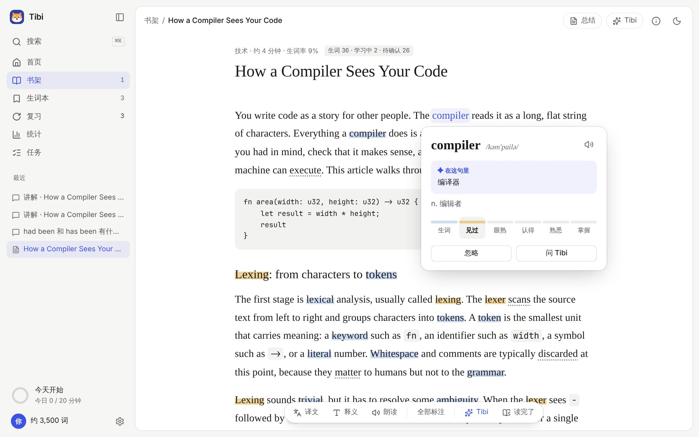

<p align="center"></p>

<h1 align="center">Tibi</h1>

<p align="center">Read English articles you actually care about, and learn the language along the way.<br>A local-first, AI-native, open-source (MIT) reading app for Chinese-speaking learners of English.</p>

<p align="center"><a href="README.md">中文</a> · English · <a href="docs/guide/README.md">User guide (Chinese)</a> · <a href="https://github.com/tumars/tibi/releases">Download</a></p>



> Tibi is built for people whose first language is Chinese: dictionary entries, AI explanations and the default interface are in Chinese. The interface can be switched to English in **Settings → General**, and Tibi can explain in English only (**Settings → Learning and review**).

## What it does

- **Import almost anything**: web pages, pasted text, EPUB books, PDF, Word, images and scanned PDFs (local OCR), plus a browser clipper extension.
- **Marks new words for your level**: a 3-minute vocabulary test, then only the words you probably don't know are highlighted. It gets more accurate as you read.
- **Click a word to understand it**: the word card shows its meaning *in this sentence* (AI-generated, cached), the ECDICT dictionary entry, phonetics and pronunciation.
- **A dictionary at hand**: works offline, understands inflected forms, Chinese lookups and misspellings; examples come from articles you've read.
- **AI reading help**: a summary, key phrases, hard sentences and reading advice on import; a full translation; select a passage to ask Tibi; keep asking in chat.
- **Remember what you read**: new words go into spaced repetition (FSRS) using the sentences you actually read, plus dictation, spelling, confusable-word and sentence-writing practice.
- **See your progress**: known words, daily reading, review performance, a study calendar, and a short note from Tibi.
- **Read aloud**: system voices or a local neural voice (Kokoro), sentence-level highlighting, speed control, sentence loop.
- **Your data stays on your computer**: everything is stored in a local SQLite database; model API keys live in the system keychain; export, back up and restore any time.
- **Works with other AI tools**: a built-in MCP server lets Claude Code, Codex and others read your progress and add words (writes need your approval).

## Install

Download the installer for your system from [Releases](https://github.com/tumars/tibi/releases): `.dmg` for macOS (Apple silicon or Intel), `-setup.exe` / `.msi` for Windows 10/11, `.AppImage` / `.deb` for Linux.

Unsigned builds: on macOS, right-click the app in Finder → Open the first time; on Windows, choose "More info → Run anyway" if SmartScreen appears.

## Getting started

1. Open Tibi, tell it what to call you, your level and your goal (and optionally take the vocabulary test).
2. Read one of the built-in sample articles, or paste an English URL into the box on the home page.
3. For summaries, meanings in context and chat, connect a model in **Settings → Advanced → Models**. [DeepSeek](https://platform.deepseek.com/) is the default suggestion; any OpenAI-compatible service works. Reading, the dictionary and review all work without a model.

## Privacy

Tibi has no server, no account and no telemetry. It only goes online for things you use: fetching a page you import, calling the model you configured, downloading the OCR language pack or the Kokoro voice the first time, and fetching your feeds. See [PRIVACY.md](PRIVACY.md).

## Development

```bash
pnpm install
pnpm core:dev -- --fake-model     # Core dev bridge with a fake model (no network, no cost)
pnpm --filter @tibi/desktop web   # UI in the browser at http://localhost:1420
pnpm dev                          # or tauri dev (needs Rust)
```

See the [developer guide](docs/dev/README.md) (Chinese) and [CONTRIBUTING.md](CONTRIBUTING.md). Design docs live in `docs/` and are kept in sync with the code; current decisions are in [DECISIONS.md](docs/DECISIONS.md).

## Credits

[ECDICT](https://github.com/skywind3000/ECDICT) (dictionary, MIT) · [FSRS](https://github.com/open-spaced-repetition/ts-fsrs) (scheduling, MIT) · [Tauri](https://tauri.app/) · [pdf.js](https://mozilla.github.io/pdf.js/) · [Tesseract.js](https://github.com/naptha/tesseract.js) · [Kokoro](https://huggingface.co/hexgrad/Kokoro-82M) (voice, Apache-2.0) · [Mozilla Readability](https://github.com/mozilla/readability) · [pi](https://github.com/earendil-works/pi) (agent runtime)

## License

[MIT](LICENSE)
