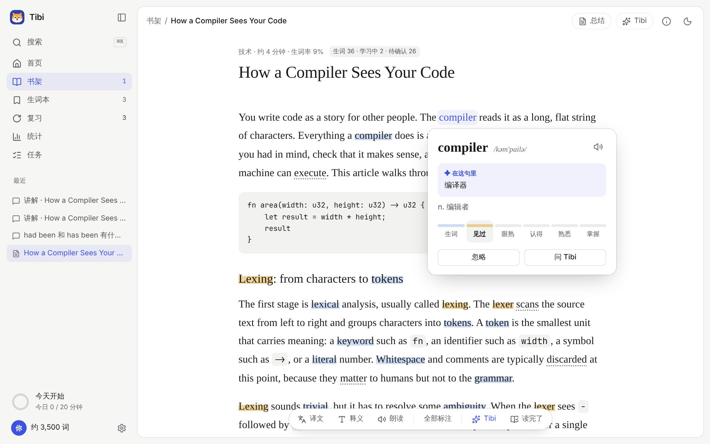
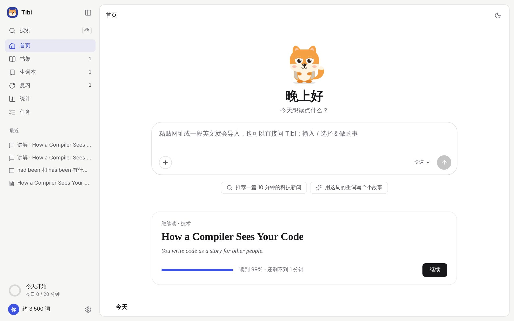
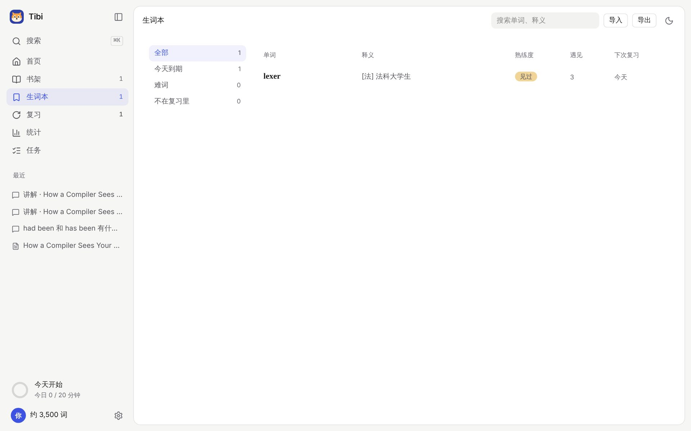

<p align="center"></p>

<h1 align="center">Tibi 缇比</h1>

<p align="center">读你感兴趣的英文文章，顺便把英语学会。<br>本地优先 · AI 原生 · 开源（MIT）的英语阅读学习工具，给中文母语的学习者。</p>

<p align="center">中文 · <a href="README.en.md">English</a> · <a href="docs/guide/README.md">使用指南</a> · <a href="https://github.com/tumars/tibi/releases">下载</a></p>



## 它能做什么

- **导入什么都行**：网址、粘贴的英文、EPUB 书、PDF、Word、图片和扫描版 PDF（本地 OCR），浏览器剪藏插件一键发送。
- **按你的水平标生词**：先花 3 分钟测词汇量，之后只标出你可能不认识的词；读得越多越准。
- **点词就懂**：词卡给出「在这句里」的意思（AI 生成、缓存），也有 ECDICT 词典释义、音标和发音。
- **AI 帮你读**：导入时自动写总结、挑出短语和长难句、给阅读建议；整篇译文、选中一段问 Tibi、在对话里继续追问。
- **记得住**：读过的生词自动进复习（FSRS 排期），复习用的是你读过的原句；还有听写、拼写、易混词、造句批改几种练习。
- **看得见进步**：已知词数、每日阅读、复习表现、学习日历，打开统计页时 Tibi 会写一段观察和建议。
- **朗读**：系统语音或本地神经网络语音（Kokoro），全文朗读句级跟随、倍速、单句循环。
- **数据在你电脑上**：所有内容存在本机 SQLite；模型 API Key 存在系统钥匙串；可以随时导出、备份、恢复。
- **接其他 AI 工具**：内置 MCP Server，Claude Code、Codex 等可以读你的学习进度、帮你加生词（写操作要你确认）。

<table><tr>
<td></td>
<td></td>
</tr></table>

## 安装

在 [Releases](https://github.com/tumars/tibi/releases) 下载对应系统的安装包：

| 系统 | 文件 |
|---|---|
| macOS（Apple 芯片） | `Tibi_x.y.z_aarch64.dmg` |
| macOS（Intel） | `Tibi_x.y.z_x64.dmg` |
| Windows 10 / 11 | `Tibi_x.y.z_x64-setup.exe` 或 `.msi` |
| Linux | `.AppImage` 或 `.deb` |

还没有签名的版本第一次打开时：macOS 在 Finder 里右键 → 打开；Windows 出现 SmartScreen 时点「更多信息 → 仍要运行」。

## 开始用

1. 打开 Tibi，告诉它怎么称呼你、你的水平和目标（可以顺手测一下词汇量）。
2. 先读内置的示例文章，或者把一个英文网址粘到首页的输入框里。
3. 想要总结、语境释义、对话这些 AI 功能，在 **设置 → 高级 → 模型** 里连一个模型。默认推荐 [DeepSeek](https://platform.deepseek.com/)（便宜、中文好），也可以填任何 OpenAI 兼容的服务。不连模型也能读、查词、复习。

更多见 [使用指南](docs/guide/README.md)。

## 隐私

Tibi 没有服务器、不需要账号、不收集使用数据。只有你主动用到的功能才会联网：导入网址时抓那个网页、调用你配置的模型、第一次用 OCR / Kokoro 时下载语言包或语音模型、订阅源抓取。发给模型的内容只到你配置的服务商。详见 [PRIVACY.md](PRIVACY.md)。

## 参与开发

```bash
pnpm install
pnpm core:dev -- --fake-model     # Core 开发桥（假模型，不联网不花钱）
pnpm --filter @tibi/desktop web   # 浏览器里跑界面：http://localhost:1420
pnpm dev                          # 或者直接 tauri dev（需要 Rust）
```

仓库结构、常用命令、怎么出安装包见 [开发说明](docs/dev/README.md)；提交前读 [CONTRIBUTING.md](CONTRIBUTING.md)。

**文档即代码**：设计决定都在 `docs/` 里，改代码时一起改文档。现在定了什么看 [DECISIONS.md](docs/DECISIONS.md)，变更记录看 [CHANGELOG.md](docs/CHANGELOG.md)。

<details>
<summary>设计文档、调研与原型</summary>

### 设计
- [总体设计方案（可视化一页）](docs/design/overview.html)：架构、数据库、数据结构、接口、技能
- [00 概念设计](docs/design/00-concept-design.md)（功能、页面、里程碑）
- [01 数据库设计](docs/design/01-database.md)
- [02 AI 助手设计：上下文、记忆、工具、权限、技能文件](docs/design/02-ai-assistant.md)
- [03 视觉语言 v2：安静的 AI 工作台](docs/design/03-visual-language.md)
- [04 设计方向 v2：调研与论证](docs/design/04-design-direction-v2.md)
- [05 技能架构：以 pi 为 harness 底座](docs/design/05-agent-architecture.md)
- [06 接口定义：WebView ↔ Core 方法、事件、能力层与 MCP 工具](docs/design/06-interface.md)（由 `docs/design/_src/build_interface.py` 生成）
- [07 吉祥物素材](docs/design/07-mascot-assets.md)
- [08 同步：手机与电脑之间](docs/design/08-sync.md)
- 归档：[v1 视觉语言「纸与墨」](docs/design/archive/03-visual-language-v1.md)

### 调研
- [01 英语学习产品与开源项目](docs/research/01-products-and-open-source.md)
- [02 学习理论与产品映射](docs/research/02-learning-theory.md)
- [03 技术选型](docs/research/03-tech-survey.md)
- [04 mac 原生感与吉祥物素材](docs/research/04-mac-native-and-mascot.md)
- [05 词光（Word Atlas）的复习设计与参考](docs/research/05-word-atlas-review.md)
- [06 iOS 英语学习与阅读产品](docs/research/06-ios-apps.md)

### 原型（HTML，浏览器直接打开）
- [首页](docs/prototypes/home.html)、[书架](docs/prototypes/library.html)、[阅读器](docs/prototypes/reader.html)、[生词本](docs/prototypes/words.html)、[复习](docs/prototypes/review.html)、[统计](docs/prototypes/stats.html)、[设置](docs/prototypes/settings.html)、[任务](docs/prototypes/tasks.html)
- [首次启动引导](docs/prototypes/onboarding.html)、[吉祥物：藏狐](docs/prototypes/mascot.html)、[手机版](docs/prototypes/mobile.html)
- 归档：[v1 原型](docs/prototypes/v1/)

</details>

## 致谢

[ECDICT](https://github.com/skywind3000/ECDICT)（词典，MIT）· [FSRS](https://github.com/open-spaced-repetition/ts-fsrs)（复习排期，MIT）· [Tauri](https://tauri.app/) · [pdf.js](https://mozilla.github.io/pdf.js/) · [Tesseract.js](https://github.com/naptha/tesseract.js) · [Kokoro](https://huggingface.co/hexgrad/Kokoro-82M)（语音，Apache-2.0）· [Mozilla Readability](https://github.com/mozilla/readability) · [pi](https://github.com/earendil-works/pi)（技能运行时）

## 协议

[MIT](LICENSE)
