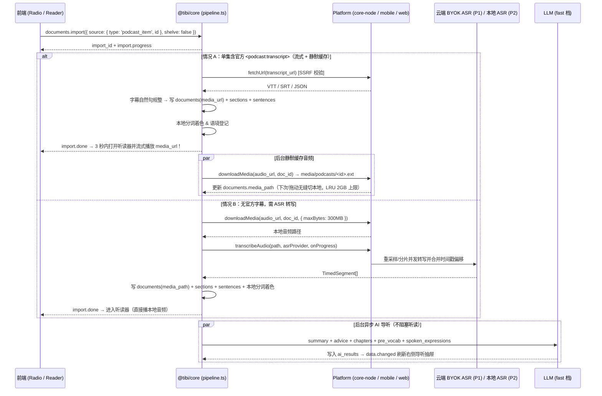

# 17 · 电台（播客听读与 AI 理解）总体方案

> 状态：**P1 与 P2 本地离线 ASR + 国内一站式预设已实现并通过测试、构建与真机浏览器端到端走查**（2026-11-25）；P2 余项（原声语境 FSRS 复习/听写、听后理解题）与 P3（直播流电台）待排期。  
> 调研依据：[`research/08-podcast-radio.md`](../research/08-podcast-radio.md)；发现与低门槛订阅细化：[`19-radio-discovery.md`](19-radio-discovery.md)；实施清单：[`dev/plan-podcast-p1.md`](../dev/plan-podcast-p1.md)、[`dev/plan-asr-onboarding.md`](../dev/plan-asr-onboarding.md)。  
> 相关：[`00-concept-design.md`](00-concept-design.md)（§3.4 音频）、[`01-database.md`](01-database.md)、[`02-ai-assistant.md`](02-ai-assistant.md)、[`08-sync.md`](08-sync.md)、[`11-rss-reader.md`](11-rss-reader.md)、[`tibi-hosted-ai.md`](tibi-hosted-ai.md)。

---

## 1. 定位与已确认方向

Tibi 的核心主张是「读你感兴趣的英文文章，顺便把英语学会」。新增**电台**功能后，将同一套“真实语料 + 无打断查词 + FSRS 复习 + AI 原生伴学”闭环延伸到**听读一体**场景。

以下核心方向已于 2026-11-24 确认：

| # | 决策点 | 确认结论 |
|---|---|---|
| **1** | **导航入口** | 桌面端侧栏**新增一级入口「电台」**（路由 `/radio`），放在「订阅」下方；与「订阅（文章）」并行独立展示 |
| **2** | **内容范围** | **P1–P2 专注播客电台（点播 RSS）**打通听读、精学与原声复习闭环；直播流电台（Live Radio）放 P3 |
| **3** | **P1 逐字稿 / ASR 路线** | **P1 采用「官方字幕 `<podcast:transcript>`（免费秒开）+ 云端 BYOK ASR（Groq / OpenAI / Deepgram）」**（同时支持手动导入 `.vtt`/`.srt` 字幕）；P2 补本地离线 ASR（macOS `SpeechAnalyzer` / Parakeet / Whisper） |
| **4** | **音频播放与缓存策略** | **流式播放 + 后台静默缓存**：有官方字幕时先直接流式播放，同时后台缓存至本地 `media/podcasts/`（默认 2 GB LRU 配额，仅清音频不删文档）；需 ASR 时先下载再转写 |
| **5** | **文档沉淀** | 按「文档即代码」沉淀至 `docs/research/08-podcast-radio.md`、`docs/design/17-podcast-radio.md`、`docs/DECISIONS.md` 与 `docs/CHANGELOG.md` |

设计边界（承袭 [`11-rss-reader.md`](11-rss-reader.md) §2 与本地优先原则）：
- **Feed / Library 两分法**：电台新单集静默拉取进 `feed_items`，**不自动下载音频、不自动转写、不自动调 AI**；用户点「听读」才导入为 `documents`（`kind = 'episode'`，`shelved = 0` 不淹没书架），点「加入书架」才留存。
- **听读复用同一套阅读器与学习数据**：单集导入后落入同一套 `documents → sections → sentences`，直接复用生词着色、点词语境释义、双语对照、生词本、FSRS-7 复习、全文搜索（`sections_fts`）与右侧 Tibi 对话面板。

---

## 2. 界面与交互设计

### 2.1 导航与信息架构

- **桌面端侧栏**（[`Shell.tsx`](../../apps/desktop/src/components/Shell.tsx)）：在「订阅」下方新增一级「电台」（`首页 / 书架 / 订阅 / 电台 / 生词本 / 词典 / 复习 / 统计`，共 8 项），配定制双色调耳机图标 `NavRadioIcon`；有新单集时同「订阅」一样只显示轻圆点，不放越攒越大的未读数。
- **路由**：
  - `/radio`：电台主页（左栏已订阅节目 + 右栏单集列表）
  - `/radio/manage`：电台源管理（搜播客 / 粘贴链接 / OPML / 开关 / 分组 / 删除 / 查错）
  - `/read/:id`：复用现有阅读器打开单集（`kind = 'episode'`）；从电台直接听读（`shelved = 0`）时面包屑显示「电台 / 节目名」、侧栏高亮「电台」，右上角提供「加入书架」（可撤销）
- **书架联动**：书架「形态」筛选由 `文章 / 书` 扩展为 `文章 / 书 / 电台`；电台卡片展示时长（如 `18:24`）与播放进度条。
- **全局迷你播放器（Mini Player）**：从听读页切换到生词本、词典、复习或统计页时音频不中断，主内容区底部收起为单行迷你播控条（节目封面、当前句字幕预览、播放/暂停、-5s/+5s、点击一键回到听读页）。
- **手机端**：底部标签栏遵循 J1–J10 保持克制，后续接入手机端时再确定独立入口或并入订阅/书架顶部切换。

### 2.2 电台页（`/radio`）与发现订阅

```
┌ 电台列表 ────────┬ 单集列表 ──────────────────────────────────────────────────┐
│ 全部          18 │ [未读] [全部] [有官方字幕 ⚡] [已保存]      排序：最新 ▾  ⟳ │
│ ★ 已保存       2 │ ────────────────────────────────────────────────────────── │
│ ── 科技 ──       │ [封面] Why LLMs Struggle With Planning     Syntax · 3 小时前│
│ 🎧 Syntax.fm   3 │ ⏱ 24 分钟 · ⚡ 官方字幕 · B2 · 含 4 个在学的词              │
│ 🎧 Changelog   2 │ Show notes 摘要两行……                                      │
│ ── 新闻与商业 ── │                              [听读]  [加入书架]  [不感兴趣] │
│ 🎧 Planet Money4 │ ────────────────────────────────────────────────────────── │
│ ── 慢速精听 ──   │ [封面] How AI Changes Coding        6 Min English · 昨天   │
│ 🎧 6 Min Eng   1 │ ⏱ 6 分钟 · 🎙 需转写（云端 ASR）                           │
│                  │ Show notes 摘要两行……                                      │
│ + 加电台  管理   │                              [听读]  [加入书架]  [不感兴趣] │
└──────────────────┴────────────────────────────────────────────────────────────┘
```

**订阅与导入入口**：
1. **搜播客（零门槛）**：点击「+ 加电台」默认提供搜索框，调用 Apple **iTunes Search API**（免费、免 Key），展示封面、节目名、作者与集数，一键订阅。
2. **粘贴链接自动发现**：支持 Podcast RSS URL、Apple Podcasts 页面链接（`podcasts.apple.com/.../id...` → iTunes Lookup 反查 `feedUrl`）、节目官网链接（走 `discoverInHtml`）以及 OPML 导入导出。
3. **内置精选英文电台种子**（用户可随时删，删后不再种回，规则同 `0009_builtin_feeds.sql`；迁移 `0011_prune_builtin_feeds.sql` 后仅保留通用且持续更新的节目）：
   - 通用精听 / 口语：*BBC 6 Minute English*、*BBC The English We Speak*（其余兴趣节目可通过「搜索播客」或链接一键添加）
4. **本地音频导入**：首页大输入框 / 书架支持拖入 `.mp3` / `.m4a` / `.wav` / `.ogg` 文件（并允许附带同目录或手动选择的 `.vtt` / `.srt` 字幕文件），走同一条听读流水线。

### 2.3 听读一体化阅读器

复用 [`Reader.tsx`](../../apps/desktop/src/pages/Reader.tsx) 的正文区与右侧抽屉，在单集文档下将底部的 [`ReadAloud.tsx`](../../apps/desktop/src/reader/ReadAloud.tsx) 切换为原生音频听读控制条 `EpisodePlayer`：

```
┌ 顶栏：电台 / Planet Money · The Economics of GPUs    [听读 ▾] [译] [生词] [Tibi] ┐
├ 正文区 ──────────────────────────────────────┬ 右侧抽屉（按需展开）───────────────┤
│ ▶ 第 1 章 · 00:00  开场与芯片短缺             │ [导听] [生词] [Tibi]               │
│                                              │                                    │
│  HOST A                                      │ 📌 本期导听                        │
│  [00:12] Welcome back to Planet Money.       │ 3–5 句中文主旨总结 + 语速/背景建议  │
│  [00:15] Today we're talking about the       │                                    │
│  `bottleneck` in AI chips...  ◀ 当前播放高亮 │ 🗂 章节时间轴（点击直达）           │
│                                              │ 00:00 开场与芯片短缺               │
│  HOST B                                      │ 04:32 台积电封装产能瓶颈           │
│  [00:24] Right, and it's not just about      │ 11:15 云厂商自研芯片博弈           │
│  making `transistors` smaller anymore.       │                                    │
│                                              │ 🔑 听前关键词 & 地道口语           │
│  (盲听模式下正文呈磨砂模糊，点按或按 V 揭晓)  │ • bottleneck 瓶颈 · 00:15 ▶        │
│                                              │ • walk me through 给我讲讲 · 03:40 ▶│
├──────────────────────────────────────────────┴────────────────────────────────────┤
│ ⏮ -5s  [▶/⏸]  +5s ⏭   00:16 / 19:24 ━━━●━━━━━━━━━━━(章节刻度)  1.0× 🔁单句 👁盲听 │
└───────────────────────────────────────────────────────────────────────────────────┘
```

**关键听读交互**：
- **三态切换**：
  1. **听读模式（默认）**：原文清晰展示，随音频逐句高亮并平滑滚动居中；点击任意句子即跳转至该句 `start_ms` 播放。
  2. **盲听模式（`B` 键）**：正文施加模糊遮罩，保留播放位置高亮；按 `V` 或单击某句临时揭晓原文，适合纯听力训练。
  3. **精听控制**：单句循环（`L`）、A-B 区间复读、倍速不变调（`0.6×`–`2.0×`）、句间自动停顿（`0–3s` 供消化或跟读）。
- **无打断查词**：播放中点击生词打开词卡 → **自动暂停音频**；关闭词卡 → **自动回退 0.8 秒并续播**（可在阅读设置关闭自动续播）。
- **多说话人对话排版**：逐字稿含 `speaker` 时按发言人分段并渲染轻量发言人标签，避免大段文字堆叠。
- **快捷键**：`Space` 播放/暂停、`←/→` 上/下一句、`[`/`]` 快退/快进 5 秒、`R` 重听本句、`L` 单句循环、`B` 切换盲听、`V` 揭晓当前句、`T` 切换双语译文。
- **无字幕且未配置 ASR 时的优雅降级**：允许先以「纯听模式」流式播放（附 Show Notes 展示与底部播控），并在正文区给出明确引导卡片：① 配置云端 ASR（推荐 Groq Whisper）一键生成逐字稿；② 导入本地 `.vtt`/`.srt` 字幕文件。

---

## 3. AI 能力设计

严格遵循 [`02-ai-assistant.md`](02-ai-assistant.md) 与 T20/R10（固定流水线跑批量分析、技能负责交互式伴学，所有外部文本经分隔符隔离防 Prompt Injection）。

### 3.1 逐字稿获取与 ASR 分层架构

| 层级 | 来源 | 阶段 | 说明 |
|---|---|---|---|
| **Tier 0（最优先）** | RSS `<podcast:transcript>`（VTT / SRT / JSON / TXT） | **P1** | 零成本、秒级拉取；经纯 TS 规整器合并碎片 cue 为完整自然句并保留 `start_ms / end_ms / speaker` |
| **Tier 1（本地离线 ASR）** | WebView Worker Whisper ONNX q8（`tiny.en` 41 MB / `base.en` 77 MB 推荐 / `small.en` 249 MB，复用 Kokoro 同份 `onnxruntime-web` WASM，魔搭镜像优先） | **已实现（T43）** | 零 API 费用、无需 Key、音频不出本机、静音边界分窗 + 实时进度与取消；与 Kokoro 下载缓存体验一致 |
| **Tier 2（云端 BYOK）** | `providers.kind = 'asr'`（**硅基流动 SenseVoice 国内免费一站式** / **Groq Whisper** / **OpenAI Audio Transcriptions** / **Deepgram Nova-3**） | **已实现** | 用户在首次引导或 设置 → 模型 里填自带 Key（硅基流动支持同平台 LLM/ASR 一键复用密钥）；长 MP3 按帧边界自动分片并拼接时间偏移 |
| **手动兜底** | 用户拖入/选择 `.vtt` / `.srt` 字幕文件 | **已实现** | 零费用离线兜底，方便配合外部转写工具或官方网页字幕 |

> **商店托管版兼容**（见 [`tibi-hosted-ai.md`](tibi-hosted-ai.md)）：Tier 0 官方字幕与 P2 本地离线 ASR **零点数消耗**；若商店版后续提供托管云端 ASR，按音频时长透明标点（如每 10 分钟 = 2 点，底层走 Groq Whisper）。

### 3.2 四阶段 AI 伴学能力

1. **听前导览（导入后后台自动运行 `fast` 档，缓存进 `ai_results`）**：
   - `summary` + `advice`：中文导听摘要 + 语速/口音/背景提示。
   - `chapters`（新增）：若源无 `<podcast:chapters>`，由模型基于带时间戳逐字稿切分 4–8 个章节 `[{ start_ms, title_zh, title_en, summary }]`，渲染到进度条刻度与右侧导听抽屉。
   - `pre_vocab`（新增）：挑出本期最影响听懂的 5–8 个核心词/专有名词（过滤用户已掌握词），带简短中文义与首次出现时间戳，供听前 30 秒预热。
   - `spoken_expressions`（新增）：针对播客口语特化，抽取地道习惯用法、动词短语、俚语及文化梗（带时间戳与原句译文）。
2. **听中理解（按需调用）**：
   - **口语语境释义**：复用 `terms.context_meaning`，当 `document.kind === 'episode'` 时在系统提示里声明“英文播客口语语境，如为口语省略、俚语或反讽请点明语气”。
   - **整篇 / 句级双语对照**：直接复用 [`translateSection`](../../packages/core/src/domain/documents/analyze.ts#L109)（每 30 句一批，逐批写回 `sentences.translation`）。
   - **选段问 Tibi**：Context Builder 在单集文档下自动注入**节目名、单集标题、当前播放时间戳、选中句及前后各 3 句完整对话（含发言人）**，支持追问背景知识、连读语音现象、语气态度等。
3. **听后闭环（遵循 A5 自然断点，单集听完在底部轻提示，不弹窗）**：
   - **听力理解自测（P2）**：调 `coach` 技能基于逐字稿生成 3 道理解题（主旨 / 细节 / 态度推断），每题绑定 `start_ms`，错题可一键跳回原声重听。
   - **微复述批改（P2）**：用 2–3 句英文总结本期收获，Tibi 给出语法修正与更自然的口语改写。
   - **原声语境 FSRS 复习卡 & 原声听写（P2 核心亮点）**：从电台标记的生词，其 `term_contexts.sentence_id` 指向带 `start_ms / end_ms` 的原句；在复习页和听写练习（`practice_logs.mode = 'dictation'`）中，播放按钮优先播放 **播客原声片段 `[start_ms - 150ms, end_ms + 200ms]`**，仅在离线无本地音频缓存时回退 TTS。
4. **智能找电台（P2 扩展 `scout` 技能）**：
   - 新增只读能力 `search_podcasts`（iTunes Search API）与 `inspect_podcast_feed`（抽最近 5 集看时长、估 CEFR、查有无官方字幕）。
   - 用户说“帮我找几个 15 分钟左右、适合练听力的科技播客” → `scout` 挑选 3 个电台经 `ask_user` 多选确认后一键订阅。

---

## 4. 数据模型与同步设计（迁移 `0010_podcasts.sql`）

不另建平行内容表，轻量扩展现有 `feeds`、`feed_items`、`documents`、`sentences`，最大化复用现有索引、FTS5、词条语境与同步触发器（T27）。

### 4.1 表结构变更草案

```sql
-- 0010_podcasts.sql（概念草案；遵循 R11 UUIDv7 / Unix ms / 软删约定）

-- 1. feeds：按 kind 区分文章订阅与电台订阅
ALTER TABLE feeds ADD COLUMN kind TEXT NOT NULL DEFAULT 'article'; -- 'article' | 'podcast' | 'radio'
ALTER TABLE feeds ADD COLUMN artwork_url TEXT;
ALTER TABLE feeds ADD COLUMN language TEXT;
ALTER TABLE feeds ADD COLUMN description TEXT;

-- 2. feed_items：存单集音频与官方字幕元数据（轻量，不存音频实体）
ALTER TABLE feed_items ADD COLUMN audio_url TEXT;
ALTER TABLE feed_items ADD COLUMN audio_mime TEXT;
ALTER TABLE feed_items ADD COLUMN audio_bytes INTEGER;
ALTER TABLE feed_items ADD COLUMN duration_ms INTEGER;
ALTER TABLE feed_items ADD COLUMN transcript_url TEXT;               -- Podcasting 2.0 <podcast:transcript>
ALTER TABLE feed_items ADD COLUMN transcript_type TEXT;              -- text/vtt | application/srt | application/json | text/plain
ALTER TABLE feed_items ADD COLUMN chapters_url TEXT;                 -- Podcasting 2.0 <podcast:chapters>
ALTER TABLE feed_items ADD COLUMN artwork_url TEXT;
ALTER TABLE feed_items ADD COLUMN season INTEGER;
ALTER TABLE feed_items ADD COLUMN episode INTEGER;

-- 3. documents：kind 扩展 'episode'，source_type 扩展 'podcast' | 'audio'
ALTER TABLE documents ADD COLUMN media_url TEXT;                     -- 远程音频直链（同步）
ALTER TABLE documents ADD COLUMN media_path TEXT;                    -- 本机 media/podcasts/<id>.<ext>（不同步！）
ALTER TABLE documents ADD COLUMN duration_ms INTEGER;
ALTER TABLE documents ADD COLUMN playback_ms INTEGER NOT NULL DEFAULT 0; -- 播放进度（同步！）
ALTER TABLE documents ADD COLUMN transcript_source TEXT;             -- 'rss_vtt' | 'cloud_asr' | 'local_asr' | 'manual' | 'none'

-- 4. sentences：增加句级时间戳与发言人（文章为 NULL）
ALTER TABLE sentences ADD COLUMN start_ms INTEGER;
ALTER TABLE sentences ADD COLUMN end_ms INTEGER;
ALTER TABLE sentences ADD COLUMN speaker TEXT;

CREATE INDEX feeds_kind ON feeds(kind, deleted_at);
CREATE INDEX sentences_time ON sentences(section_id, start_ms) WHERE start_ms IS NOT NULL;
```

- **`providers`**：表结构不变，`kind` 新增 `'asr'`，协议支持 `groq_whisper` / `openai_whisper` / `deepgram`（P2 增 `apple_speech` / `local_parakeet` / `local_whisper`），API Key 继续经 `secret_ref` 存系统钥匙串。
- **`ai_results`**：表结构不变，`task` 新增 `chapters`、`pre_vocab`、`spoken_expressions`、`comprehension_quiz`。

### 4.2 同步规格更新（[`packages/core/src/sync/spec.ts`](../../packages/core/src/sync/spec.ts)）

| 表 / 字段 | 同步策略 | 说明 |
|---|---|---|
| `feeds`（含 `kind = 'podcast'`） | **同步**（沿用现有 `exclude` 抓取状态列） | 订阅的电台列表自动跨设备同步 |
| `documents.media_path` | **加入 `exclude`（不同步）** | 本机大音频缓存路径，其他设备按 `media_url` 流式播放或按需缓存 |
| `documents.media_url` / `duration_ms` / `playback_ms` / `transcript_source` | **同步** | 跨设备续播进度（Mac 听到 12:30，手机接着听） |
| `sentences.start_ms` / `end_ms` / `speaker` | **同步** | 逐字稿时间戳跨设备共享，不重复转写 |
| `settings` 中 `radio.*` | **加入 `localGlobs`（不同步）** | 如缓存配额上限、自动刷新开关、本地 ASR 模型配置等设备本地项 |

---

## 5. 技术架构与流水线细节

### 5.1 解析层扩展（[`packages/core/src/domain/feeds/parse.ts`](../../packages/core/src/domain/feeds/parse.ts)）

- **自动识别电台源**：RSS 2.0 条目包含 `<enclosure type="audio/..." url="..." />`（或 channel 含 `itunes:*` 命名空间）时判定为 `kind = 'podcast'`。
- **提取标签**：`itunes:image` / `image/url`、`itunes:duration`（兼容 `HH:MM:SS`、`MM:SS`、纯秒数）、`podcast:transcript`（多标签优先级：`text/vtt` > `application/srt` > `application/json` > `text/plain`，英文优先）、`podcast:chapters`、`itunes:season` / `itunes:episode`。
- **纯 TS 字幕解析与自然句规整**（新增 `packages/core/src/domain/text/transcript.ts`）：
  - 解析 WebVTT / SRT / Podcast JSON 字幕。
  - 将按屏幕字数硬切碎的短 cue 按句末标点（`.` / `?` / `!`）、发言人切换及静音间隙（> 1.5s）**合并为完整自然句**，取首 cue `start_ms` 与末 cue `end_ms`，保证查词上下文、长难句分析与翻译质量，同时维持精确句级回放。

### 5.2 流式播放 + 后台静默缓存与导入流水线



### 5.3 `Platform` 接口与 RPC / 能力层扩展

**Platform 接口**（[`packages/core/src/platform.ts`](../../packages/core/src/platform.ts)）：
- `downloadMedia?(url, key, opts)`：带 SSRF 校验（T8）、单集大小上限（默认 300 MB）、下载进度回调与中断信号；写入应用数据目录 `media/podcasts/`。
- `transcribeAudio?(input, opts)`：桌面端在 `core-node` 实现云端 BYOK 调用（音频超 20 MB 时自动做轻量压缩或静音分片并发请求，规避 OpenAI/Groq 25 MB 单请求限制）；P2 接入本地引擎。
- `pruneMediaCache?(maxBytes)`：按最后使用时间 LRU 清理 `media/podcasts/`，同步清空对应 `documents.media_path`（不删文档）。

**RPC 方法与技能能力**（同步维护 `docs/design/_src/build_interface.py`）：
- `feeds.list` / `feeds.items` / `feeds.refresh` / `feeds.discover`：新增 `kind?: 'article' | 'podcast'` 筛选，复用全套逻辑。
- `podcasts.search { q, limit? }`：经 iTunes Search API 搜播客（供界面与 `scout` 共用）。
- `documents.import`：`source` 新增 `{ type: 'podcast_item', id: string }` 与 `{ type: 'audio', path: string, transcript_path?: string }`。
- `documents.update`：支持防抖更新 `playback_ms`（如每 5 秒或暂停时落库）。
- `documents.ensureMedia { id }`：确保电台单集音频缓存在本机（带 SSRF 校验），供 WebView 本地离线 Whisper 无跨域解码使用。
- `documents.transcribe { id, transcript_path?, segments?, duration_ms?, transcript_source? }`：对已导入的单集事后补跑云端 ASR 转写、回写本地离线 Whisper 片段，或导入手动字幕。
- `providers.upsert { provider, secret_ref?, reuse_secret_from? }`：支持同平台（如硅基流动）跨 LLM 与 ASR 复用密钥引用，删除时按引用计数安全回收。

### 5.4 安全、隐私与跨端边界

- **SSRF 防护**：`audio_url`、`transcript_url`、`chapters_url`、`artwork_url` 均走 T8 URL 校验与私网拦截。
- **不可信内容隔离**：逐字稿与 Show Notes 送入 LLM 时严格包裹在 `<<<ARTICLE ... ARTICLE>>>` 内，不执行其中的任何指令。
- **磁盘保护**：`media/podcasts/` 默认配额 **2 GB**（设置 → 数据可调上限及一键清理），只清理音频缓存，绝不删除逐字稿与学习数据。
- **隐私披露**：上线前更新 [`PRIVACY.md`](../../PRIVACY.md)，写明：① 搜播客访问 Apple iTunes Search API；② 播放/缓存音频直连播客源服务器；③ 云端 ASR 仅将音频发给用户自选的服务商。
- **跨端差异**：
  - **桌面端**：完整支持流式播放 + 本地静默缓存（经 Tauri `asset://` 协议读取）+ `MediaSession` 系统媒体键控制。
  - **Web 版**：RSS / VTT / iTunes 搜索走 `/api/proxy`，音频 `<audio>` 优先直连 CDN；本地大音频缓存受限于浏览器存储，默认仅流式播放 + 云端 BYOK ASR。

---

## 6. 分期实施路线图

| 期 | 目标 | 核心范围 | 验收标准 |
|---|---|---|---|
| **P1 能听能读（MVP）** | 跑通「订阅电台 → 获取逐字稿 → 听读一体 → AI 导听与查词」 | 迁移 `0010_podcasts.sql`；`parse.ts` 扩展 Podcast RSS + `<podcast:transcript>`；iTunes Search 搜播客 + 6–8 个内置英文播客；侧栏一级「电台」（`/radio`）与管理页；支持本地 MP3/M4A 与手动 `.vtt`/`.srt` 导入；**官方字幕（流式 + 静默缓存）+ 云端 BYOK ASR（Groq / OpenAI / Deepgram）**；阅读器升级听读控制条（逐句高亮、点击跳转、点词自动暂停续播、盲听模糊、倍速、单句循环、A-B 复读）；播客专用 AI 导听（摘要/章节/听前词/口语表达）；全局迷你播放器；更新 `PRIVACY.md` | 订阅带官方字幕的播客 **3 秒内**开始流式听读并完成后台静默缓存；无字幕播客配置 Groq Key 后 15 秒内转写完成；听读时点词自动暂停并在关闭后微回退续播；生词正常进入 FSRS 复习 |
| **P2 离线自由 & 原声闭环** | 零费用离线转写 + 打造“原声语境学习”壁垒 | **本地离线 ASR**（macOS 原生 `SpeechAnalyzer` / 按需下载量化 Parakeet 或 Whisper，含国内镜像）；**原声语境 FSRS 复习卡 & 原声听写练习**（复习和听写直接播播客原声切片）；听完自然断点 3 道听力理解题（错题回原声）+ 微复述批改（`coach`）；`scout` 技能支持找英语播客；`playback_ms` 与电台源多端同步；OPML 兼容 | 断网状态下可对本地音频离线转写并精听；播客收藏的生词在复习页与听写中直接播放播客原声句 |
| **P3 全场景 & 直播电台** | 拓展通勤泛听、口语跟读与实时广播流 | **直播流电台**（Radio-Browser API 接入 BBC World Service / NPR Live 等）+ 实时流式字幕 + **一键截段（Snip）转精读文档**；影子跟读（Shadowing）录音对比与 AI 连读反馈；移动端通勤锁屏播控与耳机一键标记难句 | 收听实时英文广播并显示滚动字幕，一键截取前 2 分钟生成可查词精读文档 |

---

## 7. 待细化实现项（进入 P1 开发计划时敲定）

1. **云端 ASR 大文件分片策略**：`core-node` 是否使用轻量纯 JS/WASM MP3 帧切分（免捆绑 `ffmpeg` 二进制，保持安装包体积克制），直接按 MP3 帧边界每 ~20 MB 切段并发发往 Groq / OpenAI 并按实际帧时长累加时间戳偏移。
2. **听读器与原朗读条的切换边界**：`documents.kind === 'episode'` 时默认常驻底部 `EpisodePlayer`（原声轨道），不混用 TTS 朗读条；单词卡片上的单独单词发音仍走原 TTS 引擎。
3. **内置播客种子实测**：开工前逐一验证候选英文播客 RSS 的连通性、`<podcast:transcript>` 实际覆盖率与 CDN 访问速度（含中国大陆网络环境），挑选最稳的 5–7 个作为默认种子。
